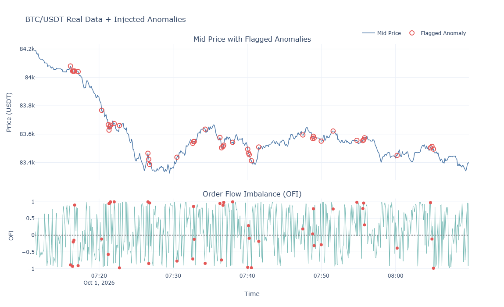

# Real-Time Fraud Detection for Big Data

**Order book anomaly detection with Apache Spark and Isolation Forest**

An unsupervised pipeline that flags statistically unusual moments in cryptocurrency order books (BTC/USDT on Binance). It needs **no labelled fraud data**: it engineers 12 features from market microstructure research, computes them with pandas or Apache Spark, scores every snapshot with an Isolation Forest, and shows the flagged moments on an interactive Plotly dashboard.

> **Important:** the system finds *unusual* activity. It does not prove fraud, manipulation or intent. Treat its output as a ranked list for human review.

---

## Why this project

Order books change thousands of times a second. Behaviours such as spoofing, layering and quote stuffing hide inside that noise, and verified manipulation labels are not publicly available. So instead of a supervised classifier, we learn what normal looks like and flag what does not fit.

## Pipeline

1. **Collect** live snapshots from the Binance public depth API (BTC/USDT, every 5 s, top 20 levels per side) or generate synthetic order books.
2. **Plant known anomalies** (for scoring only) to build a ground-truth answer key.
3. **Engineer 12 features** per snapshot (pandas for small data, Spark window functions for 300K rows).
4. **Scale and score** with `StandardScaler` + `IsolationForest` (200 trees).
5. **Review** flagged moments on the dashboard, and **evaluate** against the planted labels.

## How it works

**1. From a snapshot to numbers.** The model cannot read a raw order book, so each snapshot is turned into 12 numbers (features) that describe whether something odd is happening: how one-sided the buy and sell quantities are, how wide the spread is, how jumpy the price has been, and so on. The core one is order flow imbalance:

```
OFI = (bid qty - ask qty) / (bid qty + ask qty)      # -1 = all sellers, 0 = balanced, +1 = all buyers
```

Rolling features (volatility, z-score, ratios to a recent average) need history, so the first few rows of each run are dropped as warm-up.

**2. Scaling.** Features live on very different scales, so each one is standardised, `z = (x - mean) / std`, to stop large-valued features dominating.

**3. Scoring with an Isolation Forest.** The model makes many random cuts through the feature space. A point that is unusual gets alone after only a few cuts; a typical point needs many. The average number of cuts becomes the anomaly score:

```
score(x) = 2 ^ ( -E[path length of x] / c(n) )      # close to 1 = unusual, about 0.5 = normal
```

No labels are used at any point, which is why the method suits a problem with no public fraud data.

**4. Flagging.** Every row gets a score. The `contamination` setting only decides where to draw the line: the highest-scoring rows are flagged (`is_anomaly_pred = 1`).

**5. Evaluating without real labels.** We plant known anomalies (spoofing, liquidity vacuum, one-sided imbalance) in synthetic and real data, so every affected row is marked in an answer key. The detector never sees the key while fitting. Afterwards we compare flags with the key:

```
precision = TP / (TP + FP)      recall = TP / (TP + FN)      F1 = 2PR / (P + R)
```

**6. Scaling up.** The same features are written twice: pandas for small data and Apache Spark window functions for the 300,000-row run. The first large run scored only F1 0.383; adding the ratio features and raising `max_samples` to 4,096 lifted it to 0.811.

**7. Reviewing.** The dashboard shows flagged snapshots on the price and OFI charts, so a person can judge each one in context.

## Features

| # | Feature | Meaning |
|---|---|---|
| 1 | `ofi` | (bid qty − ask qty) / (bid qty + ask qty) at the best level |
| 2 | `depth_imbalance` | Same ratio over the top 20 levels |
| 3 | `relative_spread` | spread / mid-price |
| 4 | `rolling_volatility` | Std of log returns, last 15 snapshots |
| 5 | `price_zscore` | Distance from the 30-snapshot rolling mean, in std units |
| 6 | `quote_intensity` | Rolling sum of \|Δ best bid\| + \|Δ best ask\| (5 snapshots) |
| 7 | `depth_ratio_change` | Total depth / its 20-snapshot rolling average |
| 8–11 | `bid_qty_ratio`, `ask_qty_ratio`, `bid_depth_ratio`, `ask_depth_ratio` | Each value / its own rolling average |
| 12 | `spread_ratio` | Spread / its rolling average |

Features 8–12 were added after the first large-scale run failed: OFI and depth imbalance are capped at ±1, so a 7× spike (OFI 0.75) and a 15× spike (OFI 0.875) look almost the same. Ratios against a rolling baseline keep the size of a spike visible.

## Planted anomalies (used only for evaluation)

| Type | What changes | Size | Rows |
|---|---|---|---|
| Spoofing | Bid-side total depth | × 8–15 | 3 |
| Liquidity vacuum | Spread up, both depths down | spread × 6–12, depth × 0.15 | 4 |
| One-sided imbalance | Best-bid quantity | × 5–9 | 2 |

## Results

| Experiment | Rows | Precision | Recall | F1 |
|---|---|---|---|---|
| Small synthetic | 2,000 | 0.950 | 0.594 | 0.731 |
| Large synthetic, before fix | 300,000 | 0.383 | 0.383 | 0.383 |
| Large synthetic, after fix | 300,000 | 0.811 | 0.811 | 0.811 |
| Real BTC/USDT + injected anomalies | 584 (571 usable) | 0.711 | 0.711 | 0.711 |

**The scale-up story.** The first 300K-row run scored F1 0.383. Two fixes raised it to 0.811: (1) the five baseline-ratio features (about 0.54 on their own, see note below) and (2) `max_samples` raised from the default 256 to 4,096. The same improvement held on two further random datasets (about 0.31–0.34 before, 0.79–0.81 after).

> The intermediate ≈ 0.54 figure comes from a code comment, not a logged run. Replace it with your own output if you have one.

**Why precision = recall = F1 on the large and real runs.** The cutoff is set so the number of flagged rows equals the number of true anomalies, so false positives equal false negatives. This uses the true anomaly rate, which a live system would not know, so we also report threshold-free average precision.

### Real data with injected anomalies (`evaluate_real_with_injected.py`)

```
Loaded 584 rows (45 with injected anomalies)
After feature engineering + warmup drop: 571 rows
True anomaly rate in usable data: 7.8809%
Known anomalies : 45
Flagged by model: 45
Precision : 0.711
Recall    : 0.711
F1        : 0.711
Average Precision (threshold-free): 0.698
```

Of the 10 highest-scoring rows, 9 were injected anomalies. The top-scoring row was a genuine, un-injected snapshot with OFI ≈ +1.00 and depth imbalance ≈ +0.95, which shows that real order books sometimes become extremely one-sided on their own.

### Dashboard



Top panel: mid-price with flagged snapshots circled in red. Bottom panel: order flow imbalance (OFI) with the same snapshots marked as red dots. This is the 584-snapshot BTC/USDT run collected on 1 Oct 2026 (about 50 minutes), with known anomalies injected. The model flagged 45 snapshots, and 32 of them (precision 0.711) were injected anomalies. The rest are genuine moments the model found unusual, often with one-sided OFI near ±1.

## Repository layout

```
.
├── src/
│   ├── generate_synthetic_data.py          # 2,000-row labelled synthetic data
│   ├── generate_synthetic_data_large.py    # 300,000-row labelled synthetic data
│   ├── fetch_binance_orderbook.py          # live Binance snapshots -> CSV
│   ├── inject_anomalies_into_real_data.py  # plant known anomalies in real data
│   ├── feature_engineering.py              # 12 features (pandas)
│   ├── feature_engineering_spark.py        # 12 features (Spark window functions)
│   ├── anomaly_detector.py                 # scaler + Isolation Forest + metrics
│   ├── anomaly_detector_large.py           # 300K run with step-by-step comparison
│   ├── evaluate_real_with_injected.py      # precision / recall / F1 / AP on real + injected
│   ├── run_on_real_data.py                 # detector on untouched real data
│   └── dashboard.py                        # Plotly dashboard (HTML + PNG)
├── data/        # generated and collected CSVs (large files are git-ignored)
├── output/      # result CSVs and dashboards
└── images/      # real_injected_dashboard.png (used in this README)
```

Scripts read from `../data` and write to `../output`, so run them from inside `src/`.

## Setup

```bash
python -m venv .venv
source .venv/bin/activate          # Windows: .venv\Scripts\activate
pip install pandas numpy scikit-learn pyspark plotly requests
```

Spark runs in local mode here. On Windows, Spark's own file writer needs `winutils`; the code avoids this by collecting the finished feature table into pandas before saving.

## How to run

Run from inside `src/`, in this order:

```bash
# 1. Get data
python generate_synthetic_data.py
python generate_synthetic_data_large.py
python fetch_binance_orderbook.py

# 2. Real data: plant anomalies, then evaluate
python inject_anomalies_into_real_data.py
python evaluate_real_with_injected.py

# 3. Large-scale synthetic run (Spark features)
python anomaly_detector_large.py

# 4. Detector on untouched real data, then dashboard
python run_on_real_data.py
python dashboard.py
```

Script arguments and file names may differ in your copy; check each script's header.

## Data

Small files are included in the repo: the real BTC/USDT snapshots (`data/BTCUSDT_orderbook.csv`, 584 rows) and the result file for the real run (`output/real_with_injected_results.csv`).

The 300,000-row synthetic dataset, its features file and `output/large_scale_anomaly_results.csv` are **not** stored in the repo because of their size (GitHub rejects files over 100 MB). Regenerate them with:

```bash
python generate_synthetic_data_large.py
```

The random seed is fixed (42), so the data is identical on every run. The `.gitignore` in this repo keeps the large files out.

## Detector settings

| Setting | Value |
|---|---|
| Trees (`n_estimators`) | 200 |
| `max_samples` | default (256) on small data, **4,096** on large data |
| `contamination` | 1% on small synthetic data; the true anomaly rate when scoring |
| Scaling | `StandardScaler` on all features |
| Random seed | 42 |
| Score | `-decision_function` (higher = more unusual) |

## Limitations

- Injected anomalies are our own design: scores show how well we find the patterns we planted, not how well we would find a manipulator trying to hide.
- The real dataset is short (584 snapshots, about 50 minutes, one pair).
- The equal-count cutoff uses information a live system would not have.
- Spark ran in local mode. Windows are ordered globally, not partitioned by symbol and time, so a cluster run would need partitioning.
- Snapshots every 5 s, not message-level data, so quote stuffing is approximated.

## Future work

- Longer, multi-pair real data collection.
- Run on a real Spark cluster with windows partitioned by symbol and time bucket.
- Streaming ingestion (for example Kafka) for true real-time operation.
- Per-anomaly-type recall breakdown and harder, evasive anomalies.
- Combine with a threshold-based detector.

## References

1. Cont, R., Kukanov, A., & Stoikov, S. (2014). The price impact of order book events. *Journal of Financial Econometrics*, 12(1), 47–88.
2. Egginton, J. F., Van Ness, B. F., & Van Ness, R. A. (2016). Quote stuffing. *Financial Management*, 45(3), 583–608.
3. Do, T., & Putniņš, T. (2023). Detecting layering and spoofing in markets. *SSRN Electronic Journal*.
4. Liu, F. T., Ting, K. M., & Zhou, Z.-H. (2008). Isolation forest. *Proceedings of the 8th IEEE International Conference on Data Mining*, 413–422.
5. Zaharia, M., et al. (2016). Apache Spark: A unified engine for big data processing. *Communications of the ACM*, 59(11), 56–65.

## Disclaimer

This is an academic project. It is not financial advice and not a legal or regulatory determination of fraud.
